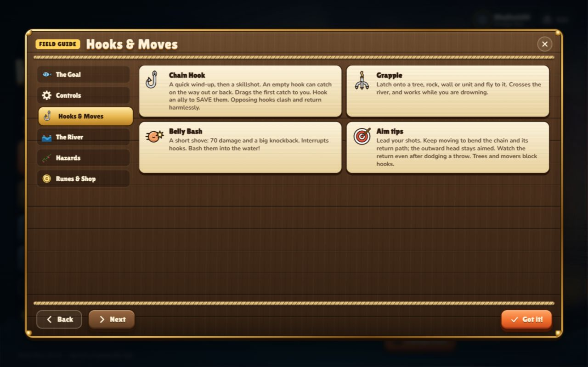
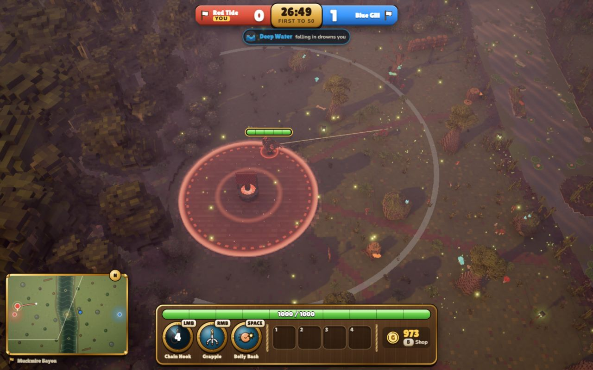

# Hook Wars: classic hook implementation and first fixes

Implemented locally on 2026-10-12 from baseline `8b0157f`. This is the first batch authorized
by Miguel after the audit, shared by browser and Steam. No public release or remote push was made.

## What changed

- **Return catches:** an empty returning head sweeps for the first eligible unit or rune. Ally
  saves, hook steals, protection, deck layers, interrupts and one-catch ownership still apply.
- **Classic curving:** ordinary outward aim stays fixed. Live simulated chain links follow the
  head on extension, then their neighbor toward the moving hand during retraction. Movement
  bends the chain and its returning head. Bendy Eel retains separate cursor steering.
- **Clashes:** heads advance on a shared clock and use relative-motion sweeps. A crossing is
  resolved at first contact, including grazing crossings and a head stopped at maximum range.
  Earlier terrain/body contact wins over a later clash. Equal-time order is terrain, clash,
  unit, rune, range/finish, then stable hook/target IDs.
- **Substitute bots:** disconnect stand-ins use the room's configured difficulty; reconnect
  keeps the same unit, progress and escrow, and clears the bot's movement/queued input.
- **Relay test:** connect the old page before its ordered replacement. A separate concurrent
  test proves one live relay regardless of handshake order, without weakening close assertions.
- **Presentation:** own-hook prediction draws a flexible chain and distinguishes chain bending
  from actual head deflection, preserving its outward speed and existing authority handover.
  Snapshot interpolation smooths live chain links, matching them from the head when links change.
  Bots recognize a returning empty hook as a new threat. The field guide explains the new rules.

The configured combat speed, range, width, damage, cooldown, wind-up and movement multipliers
are retained. Range is now capped exactly instead of overshooting by up to a substep. Simulated
chain spacing is 1.5 m with a bounded point count; rendered links retain their cosmetic geometry.

Rules made explicit: a hook carries one catch, including after a steal; rune-carrying and loaded
return hooks cannot also grab a unit; clashed heads return harmlessly; a returning empty head
that encounters intervening cover disables further catches while still coming home. Loaded
return heads do not shield allies by blocking an opposing shot.

## Reference and an audit correction

The public [Advanced v2.03d script attachment](https://www.hiveworkshop.com/threads/meat-hook-from-pudge-wars-custom.348106/)
was downloaded only into the ignored `References/` directory and inspected as behavior data.
Its extension routine preserves the head's launch direction; its linked chain and returning
head follow neighbors toward the current caster. Thus the audit's concern about missing
ordinary outward steering was too broad: classic curving does not require cursor homing or
an outward head that automatically turns with movement.

Hook Wars' implementation uses its own TypeScript, collision system, world units, safeguards
and procedural assets. No map, extracted script, Warcraft art or audio is included in the game
or commit. The exact subjective feel still needs Miguel's playtest; source analysis establishes
the motion model rather than approval of every timing/tuning value.

Local provenance:

| Ignored reference | SHA-256 |
|---|---|
| `References/Classic-PudgeWars-v2.03d.w3x` | `869464600c5ecc3ebd1bb0299a9f2203342d56d8c141d0256fcb301d9fde9224` |
| `References/Classic-PudgeWars-v2.03d-reference.j` | `7b9bea12e93cdaabfde08a89136198e092e9a7c0cf46a8b3fec7185fc394e10e` |

## Compatibility

Protocol version is now **4**. Snapshot `pts` can contain live chain points. Hook `fx` bit 16
marks that representation; bit 32 identifies a deflected head independently of the bending
chain. Browser/server/desktop builds must be updated together. Old protocol clients are refused
by the existing version gate. The fake relay's packet format itself is unchanged.

## Verification

| Check | Result |
|---|---|
| `npm run check` | Passed: typecheck, **435/435 tests**, browser build; suite about 64.5 seconds |
| New classic-hook suite | 17 checks: returns, rescues, stealing, protection, cover/layers, interruptions, deterministic swept clashes, motion and bot response |
| Client presentation coverage | Live-chain/deflection separation, predicted chain and link interpolation added; existing LAN/50/100/150 ms RTT, jitter/stall and catch handover checks pass |
| Relay file | 8/8 pass, including ordered and concurrent replacement |
| Server regression | All four substitute difficulties and same-unit rejoin verified |
| Existing simulation soaks | All maps/river/hazard modes, 5v5 and 6v6 pass |
| `npm run desktop:typecheck` | Passed against the existing Electron shim |
| `npm run desktop:build` | Server, main/preload and client bundles built |
| Browser UI | Updated Hooks & Moves guide verified at 1280x800; movement and hook casts observed in practice; no browser console errors |

The existing Vite large-chunk warning remains. Native Electron/Steam, physical controllers,
cross-machine internet play and subjective balance are not established by these checks.
Logs live in `.notes/audit/`, including `improvements-final-check.log`.

The practice screenshot below records the rendered match and HUD. It does not capture a hook
in flight; the detailed curved motion and return-catch claims are established by the regressions.

## Continue

Compare misses and returns while sidestepping, ally saves, counter-hooks and Bendy Eel in actual
play, then continue the [browser update record](browser-update-2026-10-13.md). Real Steam validation and the
browser-to-Steam product separation/funnel remain separate milestones.
