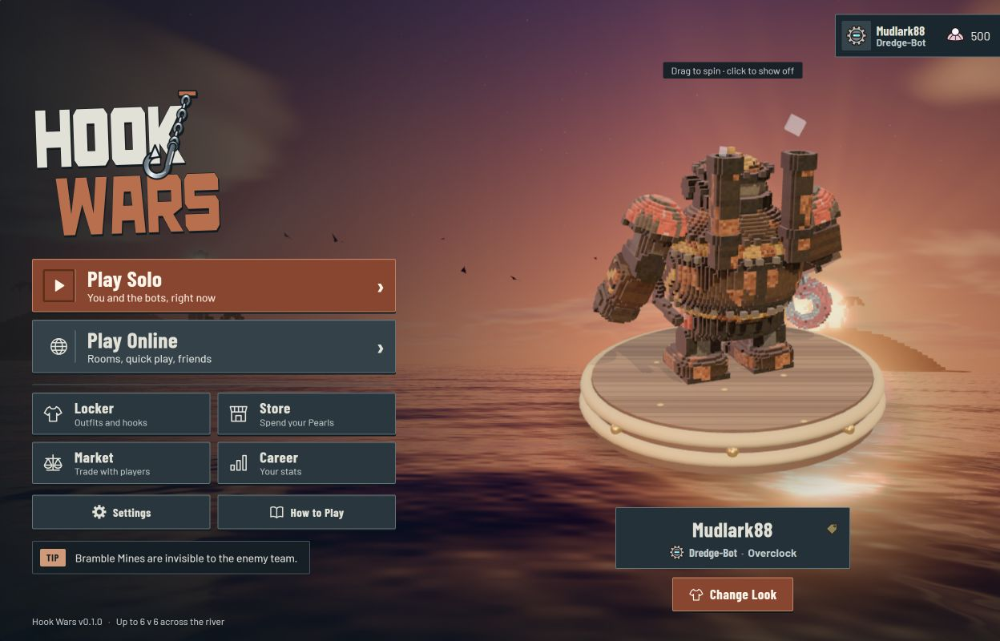
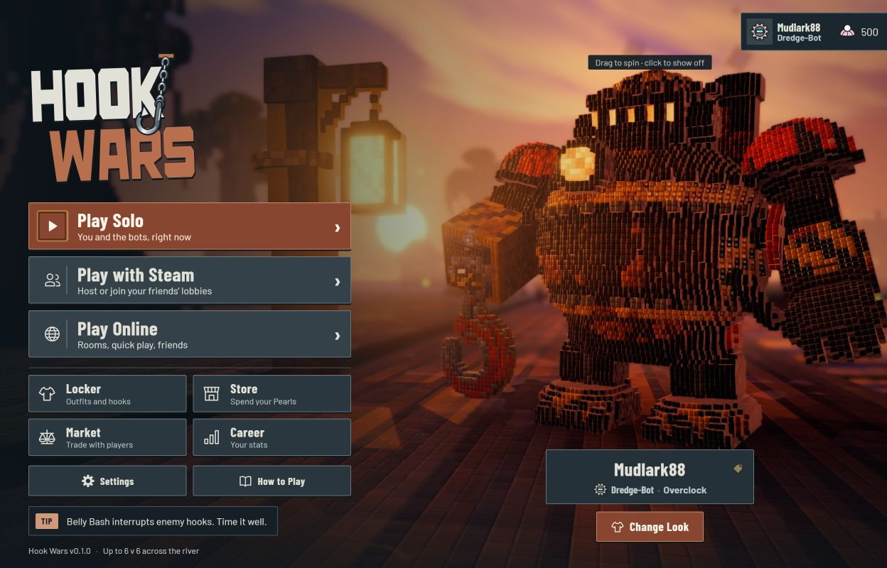
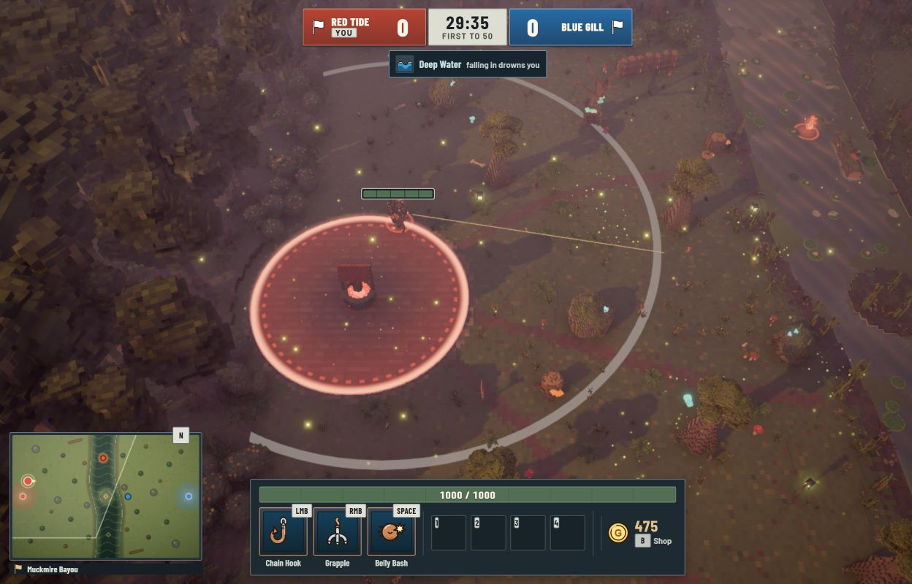
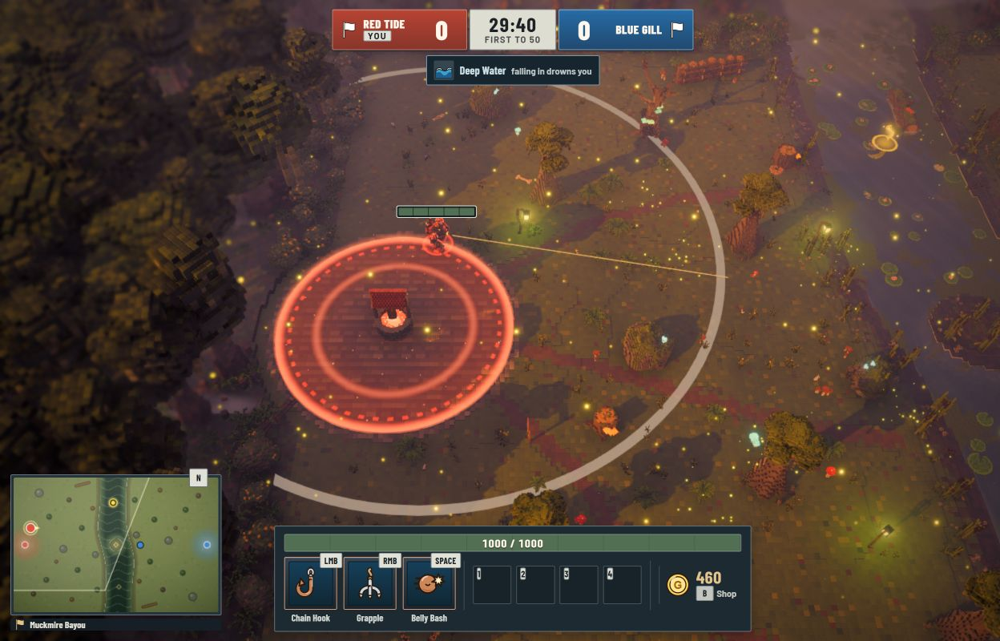

# Concept C refinement

Implemented locally on 2026-10-12 following Miguel's correction: keep the current colours,
but follow **C: Iron Dock** more closely for the Hook Wars logo, ability icons and red/blue teams.
A/D influence remains acceptable elsewhere. This supersedes the earlier interpretation of
those three elements, not the broader release plan.

## Implementation

- Authored SVG logo: tall condensed block lettering, chamfered O/S shapes, broader W,
  offset WARS and a larger steel chain/hook angled across the K. Ivory HOOK and muted copper
  WARS retain the current palette. Copper mounting plate; restrained swing; reduced-motion
  preference keeps the hook at a fixed angle. Removed the extra tagline absent from C.
- Chain Hook, Grapple and Belly Bash: copper hook head, steel/rope grapple, copper belly and
  cream impact burst. Shared procedural SVGs appear consistently wherever these icons are used.
  HUD tiles use blue inset faces, steel frames and copper ready borders. Cooldown sweeps,
  numeric countdowns and unavailable states remain intact.
- Team score plates: brick-red and cobalt-blue shaded panels, pale flags, bold white labels
  and scores, neutral centre clock. Names, flags and YOU badge supplement colour cues.
  UI team tokens also keep setup/lobby selection consistent. World geometry and combat are unchanged.

All three changes live in `client/ui/logo.ts`, `client/ui/icons.ts` and `client/ui/iron-dock.css`,
shared by browser and Steam. No generated bitmap is shipped as the logo or an ability icon.
The [concept C image](ui-concepts/2026-10-12/c-iron-dock.png) was the visual reference;
these are code-native adaptations, subject to Miguel's visual review.

## Verification

- `npm run check`: typecheck, **435 tests passed / zero failed**, browser build passed.
  Full test run took about 85.2 seconds. Log: `.notes/audit/concept-c-refinement-check.log`.
- `npm run desktop:typecheck` and `npm run desktop:build`: passed.
  Log: `.notes/audit/concept-c-refinement-desktop-build.log`.
- The first sandboxed runs hit blocked local connections (`EACCES`) and Vite file resolution
  (`EPERM`). Rerunning with permitted access passed; no protection or assertion was weakened.
- Actual menus checked in browser and Steam development stand-in at 1280x720, 1280x800,
  1024x768, 1280x1024, 1366x768, 1440x900 and 1920x1080. Logo, navigation, profile and
  showcase controls stayed inside the viewport; no page overflow.
- Live solo HUD checked in both presentations at 1280x720, 1024x768 and 1280x1024.
  Score plates, river widget, bottom bar and minimap stayed inside the viewport; bottom bar
  and minimap did not overlap. Captures below are 1280x800.
- Belly Bash use visibly changed its tile from copper ready frame to steel cooldown frame,
  with numeric countdown and dark sweep. The state returned to ready after cooldown.
- Team text `#fff7ec` has 5.08:1 contrast against the brightest red stop, 5.30:1 against
  the brightest blue stop, and higher contrast against their darker stops. These specific
  measurements are not a complete accessibility certification.
- No browser console errors in the inspected sessions. Existing Vite chunk-size warning remains.
- Original Full Crew solo preset restored after QA. Temporary tabs and dev server closed.

Steam captures use the browser-accessible development stand-in with Epic rendering. This pass
does not establish native Electron/Steam runtime, physical controller or target GPU performance.
No public deployment, release, push or new character/map art pass was performed.

## Current actual captures

Browser menu:

Steam menu, Epic development stand-in:

Browser HUD:

Steam HUD, Epic development stand-in:

