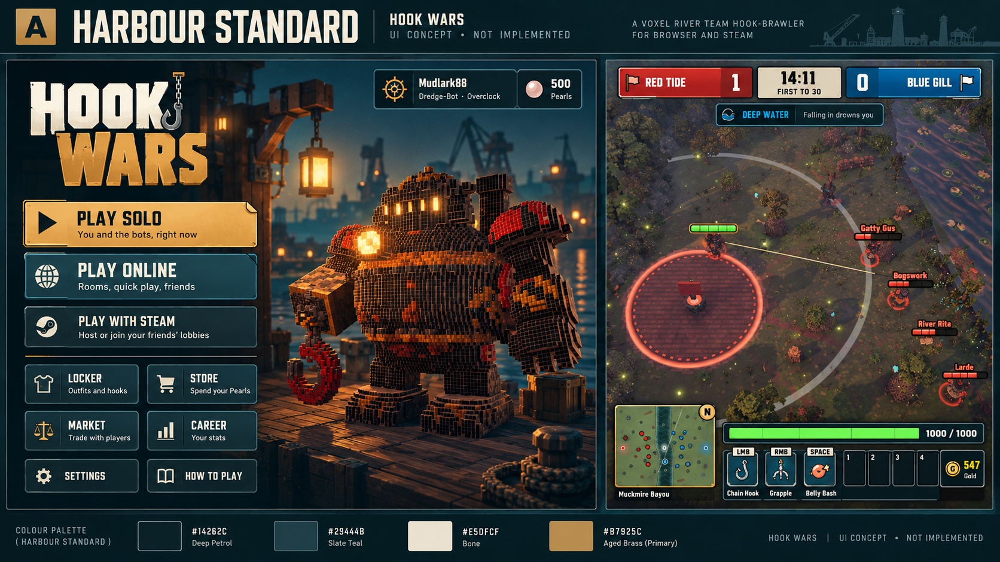
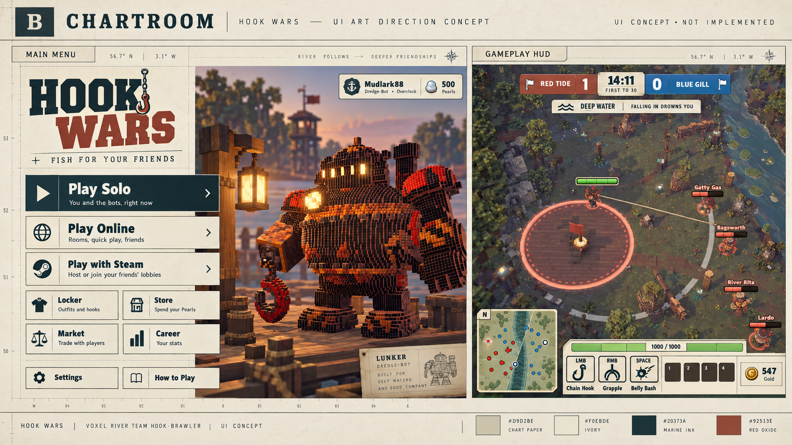
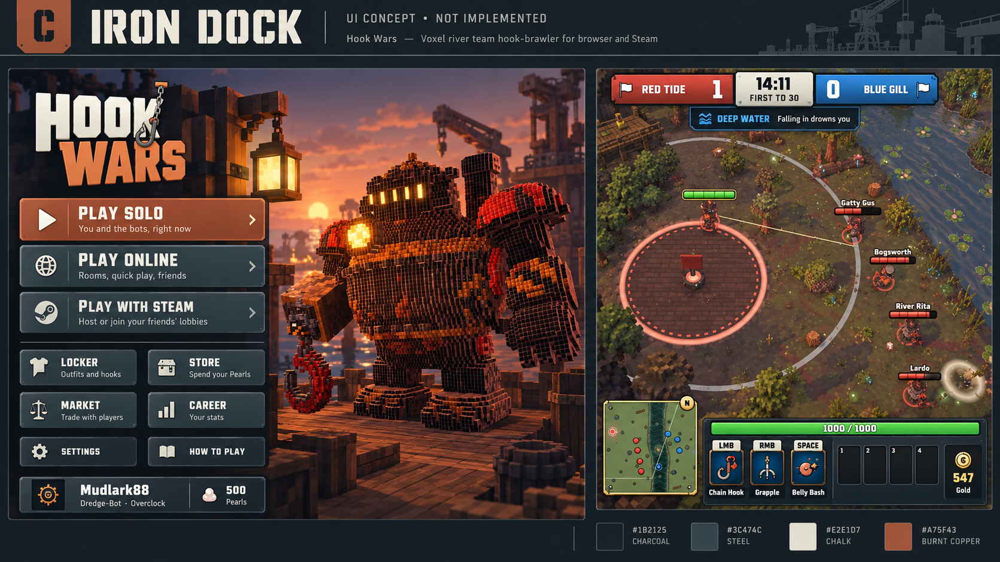
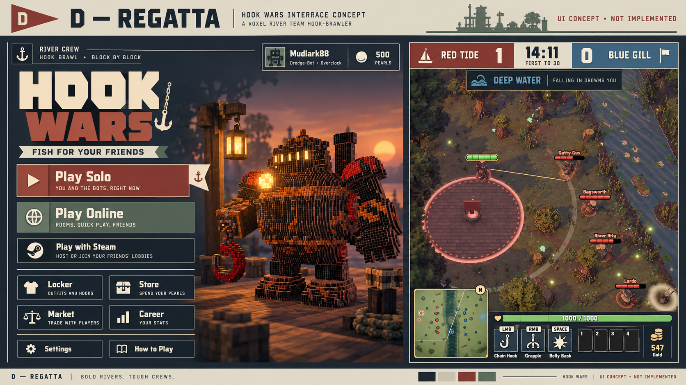

# Hook Wars UI directions

Prepared 2026-10-12 for Miguel's visual selection. These are generated concept mockups,
not screenshots of implemented UI. The mechanics batch is complete in shared browser/Steam
code; native Steam and human feel validation remain open. The wider release plan is ongoing.

## Brief

Retain a clear, organized interface while replacing the current glossy rounded buttons,
gold bevels, heavy glow and generic palette. No neon-heavy styling. Make the UI original,
modern and consistent across browser and Steam. Preserve voxel Lunkers and gameplay identity.
**Owner selection, 2026-10-12:** Miguel prefers **C: Iron Dock**, likes A and D, and excludes B.
He particularly likes C's colours and the hook swinging across the K. The shared code-native
UI implementation follows C. The generated boards below remain historical concepts.
Miguel subsequently clarified that C's logo, ability icons and team score plates should be
followed more closely, using the current muted colours. That correction is implemented in the
[C refinement](ui-concept-c-refinement-2026-10-12.md).

## Research and design judgment

- [NN/G: flat-design best practices](https://www.nngroup.com/articles/flat-design-best-practices/):
  clickable elements need consistent visual signals, recognizable icons with labels, contrast
  and purposeful depth. Sharper controls must still look usable.
- [Xbox contrast guideline](https://learn.microsoft.com/en-gb/gaming/accessibility/xbox-accessibility-guidelines/102):
  test text against the least contrasting part of its background; use solid/semiopaque
  backplates and non-colour identification. Contrast must survive moving game scenes.
- [Sea of Thieves: custom text overlay](https://support.seaofthieves.com/articles/24134290814994-Custom-Text-Overlay):
  a useful nautical-game precedent for separating stylized identity from clear readable text.
- Official examples studied as identity references: [Hades II](https://www.supergiantgames.com/games/hades-ii/),
  [DREDGE](https://www.blacksaltgames.com/games/) and [Panic](https://www.panic.com/).
  My design judgment: recognizable typography, a focused palette and deliberate composition
  are better sources of individuality here than extra ornament. These are references, not
  an objective ranking or a claim that any particular visual style causes commercial success.

## Four candidates

| Option | Character | Palette | Tradeoff |
|---|---|---|---|
| A: Harbour Standard | Matte contemporary harbour signs; clipped corners, precise lines | Petrol, slate teal, bone, muted ochre | Best balance of maritime identity and modern readability; dark surfaces need strong contrast |
| B: Chartroom | Warm chart-paper panels; editorial labels and navigation rules | Oat, ivory, marine ink, red oxide | Most readable light direction; more serene than aggressive |
| C: Iron Dock | Dock machinery control plates; straight edges and restrained technical type | Charcoal, steel, chalk, burnt copper | Strongest fit for Dredge-Bot; must remain welcoming to the other families |
| D: Regatta | Modern sailing-club poster typography and scorecards | Slate, cream, brick, sail green | Most graphic and distinctive; display lettering must not replace readable body type |

The initial Codex recommendation after reviewing the four renders was D: Regatta:
it gets individuality from lettering, simple signal-flag geometry and a restrained palette.
A is the safer dark maritime alternative; B offers the largest light-panel change.
Miguel's subsequent choice of C takes precedence. The UI uses one design system shared by
browser and Steam; actual screenshots and validation are in the implementation record.

See the [Iron Dock implementation record](ui-iron-dock-2026-10-12.md) for actual captures.

The images use the Steam menu as their common comparison view. The Steam-only action would
be omitted in the browser. They illustrate direction, not a final pixel specification: preserve
character showcase/profile controls, resolve small icon/label differences, reduce fluorescent
health colours (particularly A/C), keep supporting text readable, and verify actual contrast
and focus states during implementation. Generated backgrounds do not establish render quality.

## Concept images

## Common improvements proposed

1. Give Play clear visual priority. Keep Locker/Store/Market/Career together and secondary.
2. Use one shape vocabulary, spacing grid, icon family and colour system throughout menus,
   setup, settings, lobbies, equipment, in-match shop, guide and match results.
3. Keep scores, time, river warning, health, abilities and minimap legible at screen edges;
   reserve the middle for aiming and catches. Avoid decoration competing with the hook.
4. Pair team colours with names/symbols. Show keyboard focus, pressed/selected, disabled,
   cooldown and errors through distinct states, not just hue changes.
5. Keep the same visual language across editions. Steam adds its genuine platform actions;
   browser's Steam offer waits for the real page and agreed edition table.
6. Verify short/square viewports, readable text, reduced motion, low graphics and busy combat.
   Full controller menu navigation remains an implementation milestone, not a mockup claim.

## Generation

Built-in imagegen skill/tool; one separately specified concept per option. Inputs are actual
local menu/gameplay audit captures used as visual references. The generated scenery is
illustrative and cannot serve as a store screenshot. Prompts are saved alongside the concepts.
No generated raster is proposed as a shipped UI asset; implementation should use CSS/SVG
and existing procedural scene/assets unless Miguel changes the asset policy.
