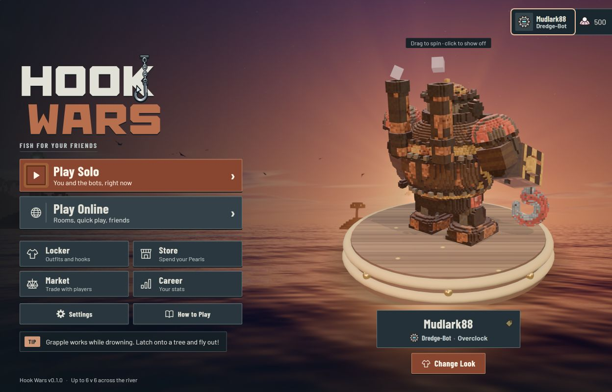
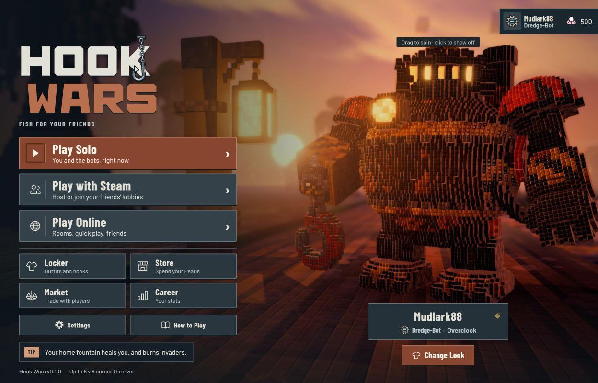
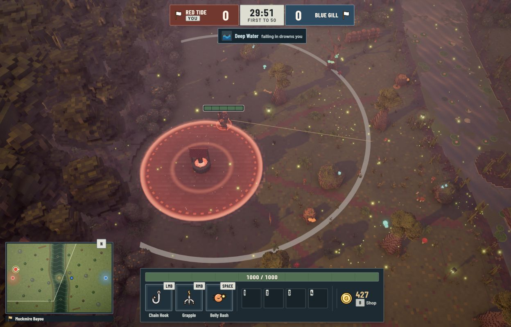
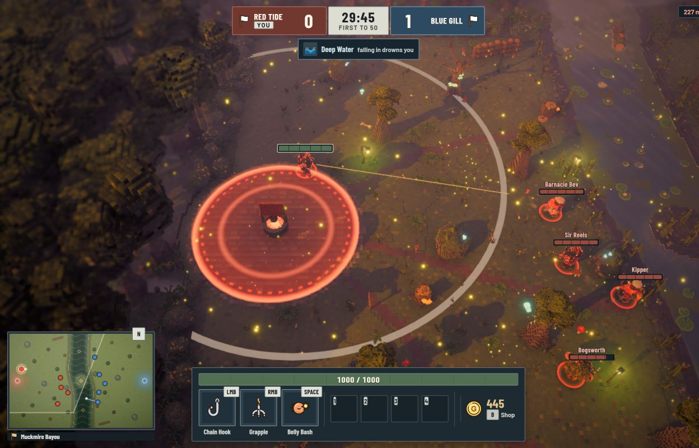

# Iron Dock UI implementation

Implemented locally on 2026-10-12 after Miguel selected concept C. He likes A and D too,
excludes B, and specifically favours C's colours and the hook swinging across the K.
This record describes actual code and screenshots. The [concept boards](ui-directions-2026-10-12.md)
remain illustrations of the earlier options.

**Later refinement:** Miguel requested a closer match to C for the logo, three abilities and
team score plates. The [C refinement record](ui-concept-c-refinement-2026-10-12.md) contains
the current implementation and newer captures; the captures below show the earlier pass.

## Result

- One CSS design layer shared by browser and desktop: charcoal panels, steel controls,
  burnt copper primary actions, chalk text, straight edges and modest pressed depth.
- Original SVG wordmark with angular letters and a restrained steel-hook swing across the K.
  The logo has an accessible name; decorative arrows and icons stay out of control names.
- Locally bundled Barlow body type and Barlow Condensed headings; original monochrome action
  symbols for navigation. Item, family and ability icons retain their recognizable identities.
- Shared treatments for setup, settings, online/Steam screens, lobby, locker, store, market,
  career, guide, shop, HUD and match-result components. Layout and state/authority logic are preserved.
- More restrained health bars, rectangular abilities/item slots, clear cooldown sweeps, labelled
  team colours, minimap frame, selected/disabled/error states and visible keyboard focus.
- OS reduced-motion preference disables UI animations/transitions, including the logo.
- Overlay scrims preserve the visible game context. The shop close control has a label and B hint.

The stylesheet follows existing screen/layout styles deliberately; `client/ui/iron-dock.css`
owns appearance without duplicating screen or simulation logic. Fonts use pinned npm packages
5.3.0. Their OFL notices ship in `public/licenses/`, which is copied into both output bundles.
The unused Lilita One/Nunito font packages were removed. No generated UI raster ships.

## Readability checks

Core solid colour pairs measured from the theme tokens:

| Pair | Contrast |
|---|---|
| Primary action text/background | 6.57:1 |
| Primary hover text/background | 5.37:1 |
| Standard button text/background | 8.01:1 |
| Supporting text/panel | 8.03:1 |
| Copper section label/panel | 5.60:1 |
| Health text/full-health fill | 5.19:1 |

These are specific colour checks, not a complete accessibility certification. Dynamic states,
world labels, input devices and individual player needs still require release testing.

## Verification

- Root typecheck, 435/435 regressions and browser build pass. No new simulation behaviour is introduced.
- Desktop shim typecheck and desktop server/main/preload/client bundles pass.
- Live browser navigation inspected: menu, solo settings, settings, field guide, locker, store,
  market, career, practice HUD and in-match shop. Profile/showcase and preset controls remain usable.
- Steam stand-in: menu, Epic presentation, lobby list, local host lobby, live 5v5 match, pause
  panel and leaving the room inspected. The test lobby was closed. This is not native Steam validation.
- Browser and Steam menus checked at 1280x720, 1280x800, 1024x768, 1280x1024, 1366x768,
  1440x900 and 1920x1080. Essential menu controls stayed within the viewport.
- Live HUD checked at 1024x768, 1280x1024 and 1280x720: essential widgets stayed within
  the viewport, and the minimap and bottom bar did not overlap.
- Keyboard focus observed: 2 px copper outline with 4 px separation. Decorative navigation
  chevrons are hidden from accessibility names. Guide/selected controls and disabled state reviewed.
- Browser console errors: none in the inspected sessions. Existing Vite large-chunk warning remains.

Native Electron/Steam accounts, physical controllers, full controller menu support and sustained
performance on target hardware are still outside this evidence. HUD score/pause views were inspected;
the final-match result uses the shared styles but was not reached in this short live playtest.
Final full suite: 435 passes, zero failures, about 83.3 seconds while browser QA was active.
Logs: `.notes/audit/iron-dock-check.log` and `.notes/audit/iron-dock-final-check.log`.
The original Full Crew preset was restored, temporary tabs closed and test server stopped.

## Actual captures

Browser menu:

Steam-style Epic menu, using the development stand-in:

Browser match HUD:

Steam-style Epic match, development stand-in:

More captures of setup, guide, settings, locker, store, career, lobby and pause live alongside these.

## Steam graphics: what exists and what remains

The concepts used the actual **Steam Epic menu capture** as their character reference, rather
than proving a browser-only or future upgraded model. The generated scenes are not engine output.

The current code already has:

- Nominal character grid spacing of 0.05 m and showcase spacing of 0.025 m, before the family's
  rig scale (`resOf(fine)` returns 2).
  Fine builds add trim/detail to the family models. **Browser turntable previews also use showcase
  geometry.** It is inaccurate to promise that every Steam view has a different base character.
- Epic in-match detail selection by projected voxel size, with build/in/out thresholds and
  cached geometry. At normal 1080p/1440p gameplay zoom the higher geometry generally does not
  activate; it is designed for close-up views and sufficiently large drawing buffers.
- Shared terrain columns: 0.25 m near the arena and 1 m for distant surroundings. Steam Epic adds
  per-map wet surfaces, puddle/shore/bed detail, bevel/seam shading, lighting, mist, shafts, grading
  and other cinematic effects. These are genuine renderer differences, not an entirely separate map mesh.

Miguel's expectation of a substantially richer paid Steam edition is confirmed. A dedicated art
and performance pass should combine larger blocks for body mass and terrain forms with finer
face/hand/mechanical/environment detail, control excessive seam noise, and compare the same scene
across editions. Keep hitboxes and map geometry consistent. Measure GPU/CPU/frame time and clarity
before making higher detail the default or promising minimum specs. This UI pass preserves the
existing graphics tiers; it does not claim that the full paid/browser art distinction is finished.
